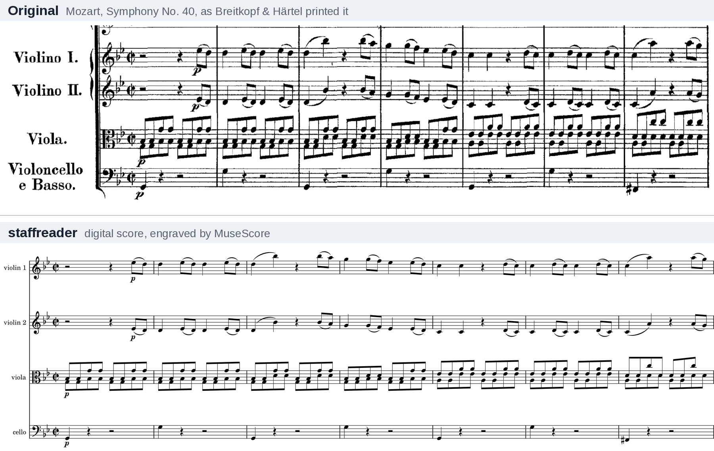

# staffreader

Optical music recognition (OMR) for printed scores: a scanned page in, MusicXML out.



staffreader is a proof-of-concept tool, not production ready.

It was built with AI assistance. Agents assisted with code, experiments and documentation under human direction.

## What it is for

Much printed music is in the public domain but has no free digital edition. staffreader reads scans of those editions into MusicXML, which a person then checks against the scan, bar by bar. It was built to transcribe the scores for Edifree, an app in progress, and these works were transcribed with it:

| Work | Edition | Pages | Time from scan to score |
|---|---|---|---|
| Boccherini, String Quintet in E major, Op. 11 No. 5, all four movements | Ricordi, revised by Enrico Polo | 38 | about 40 minutes of checking |
| Mendelssohn, Wedding March from *A Midsummer Night's Dream* | Breitkopf & Härtel, as reprinted by Dover | 13 | 73 minutes |
| Rimsky-Korsakov, Flight of the Bumblebee | W. Bessel & Co., 1904 | 6 | about an hour |

## How well it reads

Pages of printed scores, each from the edition its answer key was transcribed from: the share of notes read right at pitch and onset (F1), and the share of bars needing no correction.

| Music | Pages | staffreader | Audiveris 5.11 |
|---|---|---|---|
| String quartets | 4 | 0.99 notes, 95% of bars | 0.58 notes, 34% of bars; no reading of 2 pages |
| Voice and piano | 4 | 1.00 notes, 97% of bars | 0.79 notes, 56% of bars |
| Orchestra | 8 | 0.98 notes, 92% of bars | 0.83 notes, 66% of bars; no reading of 1 page |
| Solo piano | 5 | 0.91 notes, 64% of bars | 0.33 notes, 2% of bars |

On 4,015 staves from scanned volumes that never trained, it reads 0.95 of notes right and 87% of bars exactly. Solo piano is the weakest. [Results](docs/results.md) has the full measurements.

## How it works


A classical layout stage finds the page's staves, systems and barlines. A neural network of 26M parameters (a ConvNeXt encoder and a transformer decoder) reads each staff's notes and marks, and a smaller one reads lyrics and instrument names. The staves are then put back together into parts, and a run of pages into one work.

It is trained only on free data: CC0 and public-domain scores from PDMX engraved by MuseScore, and public-domain scans paired with OpenScore's CC0 transcriptions of them. Nothing licensed for non-commercial use only was trained on.

## Trying it

You need [uv](https://docs.astral.sh/uv/) and poppler's `pdftoppm`. An NVIDIA GPU makes reading fast; the CPU works, more slowly.

```bash
git clone https://github.com/alexzah/staffreader && cd staffreader
uv sync
uv run staffreader fetch                                   # the trained models
uv run staffreader read score.pdf --page 1 -o page1.musicxml
```

## More

- [Using it](docs/usage.md): installing, reading, settings and commands
- [How it works](docs/how-it-works.md): the layout stage, the readers and how parts are assembled
- [The models](docs/model.md): what they were trained on and what they are for
- [Results](docs/results.md): every measurement, against Audiveris
- [How it is measured](docs/evaluation.md): the test pages, the answer keys and the scoring
- [Data and training](docs/training.md): how the training data was made
- [Improving it](docs/improving.md): the loop of measuring, diagnosing and testing fixes

## License

The code and the models are licensed under the Apache License 2.0. The answer keys are dedicated to the public domain under CC0 1.0.

The training data comes from [PDMX](https://zenodo.org/records/14648209), [OpenScore](https://openscore.cc), and scans from [IMSLP](https://imslp.org) and the Internet Archive. Audiveris and oemer are measured against as baselines, and MuseScore engraves the training data and the test pages.
