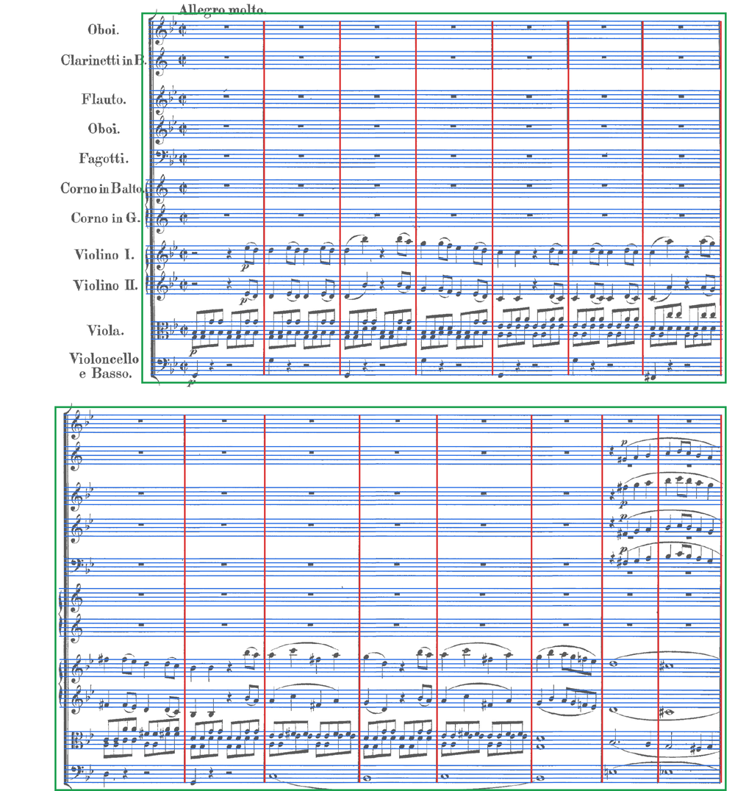

# How it works

staffreader reads a page in four stages: it finds the page's staves, systems and barlines; it reads each staff's notes and marks; it reads the words under and beside the staves; and it puts the staves back together into parts. A work of several pages is read page by page and joined.

## 1. The layout stage

`layout.py` finds a page's staves, groups them into systems and finds each system's barlines. It uses no learning, so it never meets a page it was not trained for.

1. **Straightening.** The paper is evened out against a blurred copy of itself and thresholded. Anything clearly darker than the paper counts as ink, so faint lines survive. The page is cut into vertical strips, and the shift of the staff lines from strip to strip gives the tilt to undo. A page that bends, as the pages near a book's spine do, is flattened band by band.
2. **Line thickness and spacing.** These are the most common vertical runs of ink and of paper.
3. **Staves.** Staff lines are what survives a long horizontal opening, after short gaps are bridged. Every run of five lines a staff space apart is a candidate, and candidates are taken longest first. Each of the five lines must run most of the staff's length, so a ledger line never stands in for a staff line. A staff's ends are followed out past clefs and key signatures, tracking each line as it drifts.
4. **Systems.** Staves joined at their left edge by a line are one system. Brackets and braces are told from letters by their shape.
5. **Barlines.** A barline fills a staff from top line to bottom line. A stroke with a notehead touching it is a stem, and so is one that reaches past the staff; repeat dots stand apart and do not count. Most of a system's staves must agree on a barline. Where a system's barlines cross between staves, a stroke that does not cross is a stem. A double barline or repeat counts once.

On all 103 test pages, engraved and scanned, the layout stage finds every staff, system and barline.

## 2. The staff reader

Each staff is cut from the straightened page, scaled so its staff spaces are the same size every time, and read by one neural network (`model.py`, 26M parameters):

- a ConvNeXt-style encoder turns the staff, 160 pixels tall, into a grid five rows high and an eighth of its width across;
- two transformer layers let every place on the staff see every other, so a key signature or a clef informs a note far to its right;
- a six-layer transformer decoder writes the staff as tokens, one at a time.

The tokens (`tokens.py`, `marks.py`) spell a staff the way MusicXML does: clef, key and time; each note's accidental, pitch, length, dots, tuplet, tie and chord; rests; voices; barlines, repeats and endings. Marks follow the note they belong to (articulations, ornaments, slurs, fingering and more), or go before the note at their onset (dynamics, hairpins, pedal, words spelled letter by letter). New kinds of marks are only ever new tokens, so older models keep reading.

The staff is read twice, once for its notes and once for its marks, and the marks are placed on the first reading's notes. Reading both at once cost note accuracy.

Decoding knows some music theory and checks the reading against the page:

- a staff ends after as many barlines as the layout stage found;
- a system's staves share their key signature, and a staff read with another key is read again;
- a bar that does not add up to its time signature is read again with triplets allowed, and a bar every staff lengthens alike is taken for a change of meter;
- a page that prints no time signature takes the meter its bars add up to most often;
- a mark never follows itself, and at most six marks come between two notes.

## 3. The text reader

A second, smaller network (`text.py`, 4.4M parameters, trained with CTC) reads lines of text: each verse of lyrics under a staff, and each instrument's name at a system's left. `lyrics.py` attaches the syllables, in order, to the notes the staff reader marked as sung, and mends words split across lines. `instruments.py` turns a label such as "Cor. in G." or "Violoncello e Basso" into an instrument and its transposition, from a table of historical names in Italian, German, French and English.

## 4. Assembly

`baselines/staffreader.py` joins the staves of each system into parts:

- braced staves (a piano's two hands) become one part;
- labels name the parts, and a staff printed for two players ("a 2", "1. 2.") is read for both;
- dynamics, hairpins and words printed between a piano's two staves are kept once;
- a part a system leaves out rests there.

`read_work` (`staffreader read --pages 12-15`) reads a run of pages as one work. A `Work` carries the parts, their labels, time signatures and keys from page to page, so a page that prints no labels still knows which staff is which.

`positions.py` finds where each note sits on the page, so a mark read from the page can be placed at the right note.

## What it does not read

- Handwritten scores.
- Tablature and one-line percussion staves: the layout stage assumes five lines.
- Fingering on printed pages (it reads fingering only on engraved ones), and many directions written in words.
- Solo piano is read least well, about six bars in ten exactly on the test pages: voices that cross, chords with notes on both sides of the stem, and triplets printed without their "3".
